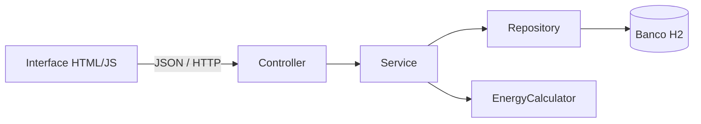
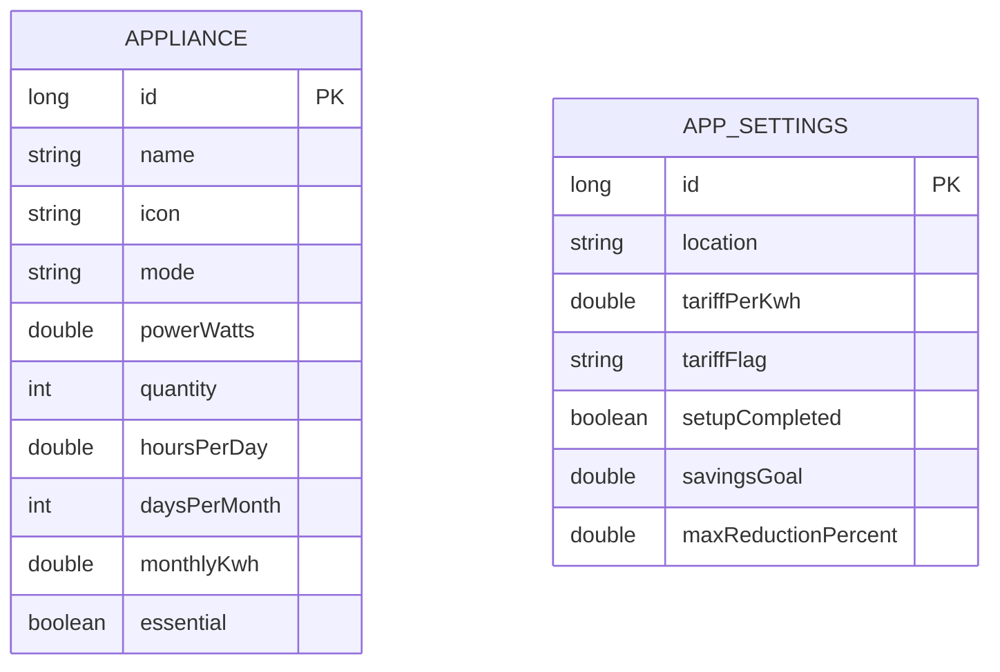

# EcoWatt

Aplicação acadêmica para estimar o consumo residencial de energia, comparar hábitos e planejar uma meta de economia. O projeto foi reestruturado a partir do protótipo HTML original para separar interface, regras de negócio e persistência.

No primeiro acesso, a pessoa precisa informar cidade/UF, tarifa-base local e bandeira tarifária vigente. Esses dados ficam salvos no H2 e são usados em todos os cálculos, simulações e relatórios.

## Tecnologias

- Java 21;
- Spring Boot 4.1.2;
- Spring Web (API REST);
- Spring Data JPA;
- H2, banco de dados embarcado;
- HTML, CSS e JavaScript sem framework;
- JUnit 5 e MockMvc para testes.

O H2 é suficiente para a feira: não exige instalação de servidor e mantém os dados no arquivo `data/ecowatt.mv.db`. Para uma implantação com vários usuários, a troca natural seria PostgreSQL.

## Como executar

Pré-requisitos: JDK 21 ou superior e Maven 3.6.3 ou superior.

```bash
mvn spring-boot:run
```

Depois, abra [http://localhost:8081](http://localhost:8081).

Se o Maven não estiver configurado no terminal, use o JAR já empacotado:

```powershell
& 'C:\Program Files\Java\jdk-21.0.12\bin\java.exe' -jar '.\target\ecowatt.jar'
```

Para executar os testes:

```bash
mvn test
```

Também é possível abrir o projeto em IntelliJ IDEA ou Eclipse e executar a classe `EcoWattApplication`.

O passo a passo completo para outro integrante da equipe está em [docs/GUIA_INTELLIJ.md](docs/GUIA_INTELLIJ.md).

## Organização do projeto

```text
src/main/java/br/edu/ecowatt
├── controller   recebe as requisições HTTP
├── dto          define os dados de entrada e saída da API
├── exception    padroniza erros e mensagens de validação
├── model        representa as tabelas e os tipos do domínio
├── repository   acessa o banco com Spring Data JPA
└── service      contém validações e cálculos de energia

src/main/resources
├── static       interface HTML, CSS e JavaScript
└── application.properties
```

Fluxo de uma operação:



## Modelo de dados



O modo `POWER_TIME` usa a fórmula:

```text
kWh/mês = potência (W) × quantidade × horas/dia × dias/mês ÷ 1000
```

No modo `MONTHLY_KWH`, o consumo informado na etiqueta já é considerado o total mensal e não é multiplicado pela quantidade.

O custo usa duas parcelas claramente separadas:

```text
tarifa efetiva = tarifa-base local + adicional da bandeira
custo mensal = consumo mensal (kWh) × tarifa efetiva
```

Bandeiras disponíveis no projeto:

| Bandeira | Adicional por kWh |
|---|---:|
| Verde | R$ 0,00000 |
| Amarela | R$ 0,01885 |
| Vermelha — Patamar 1 | R$ 0,04463 |
| Vermelha — Patamar 2 | R$ 0,07877 |

Os valores seguem a tabela publicada pela [ANEEL](https://www.gov.br/aneel/pt-br/assuntos/tarifas/bandeiras-tarifarias). A tarifa-base deve ser copiada da conta de energia sem somar novamente o adicional da bandeira.

## Endpoints principais

| Método | Caminho | Finalidade |
|---|---|---|
| `GET` | `/api/appliances` | Lista aparelhos e valores calculados |
| `POST` | `/api/appliances` | Cadastra um aparelho |
| `PUT` | `/api/appliances/{id}` | Atualiza um aparelho |
| `DELETE` | `/api/appliances/{id}` | Exclui um aparelho |
| `POST` | `/api/appliances/demo` | Carrega a residência de exemplo |
| `GET/PUT` | `/api/settings` | Consulta ou atualiza região, tarifa, bandeira e meta |
| `GET` | `/api/analysis/summary` | Retorna KPIs e ranking |
| `POST` | `/api/analysis/simulation` | Simula uma mudança sem alterar o cadastro |
| `GET` | `/api/analysis/savings-plan` | Gera sugestões para a meta |

## Banco de dados

Não é necessário instalar outro banco. O console do H2 fica disponível em [http://localhost:8081/h2-console](http://localhost:8081/h2-console) durante a execução.

Use estas informações:

```text
JDBC URL: jdbc:h2:file:./data/ecowatt
User Name: sa
Password: (deixe em branco)
```

## Decisões adequadas ao nível da turma

- uma única aplicação, sem microsserviços;
- Java organizado em camadas fáceis de demonstrar;
- banco embarcado em vez de infraestrutura externa;
- JavaScript puro, sem etapa extra de compilação;
- regras matemáticas explícitas, sem chamar o algoritmo de inteligência artificial;
- testes pequenos para conectar cálculo, requisitos e qualidade de software.
- configuração inicial obrigatória para evitar simulações com uma tarifa genérica;
- composição do custo visível no painel e no relatório para facilitar a conferência.

O arquivo `EcoWatt_Final_InovaTech_2026.html` foi mantido na raiz apenas como referência do protótipo original. A interface usada pela aplicação está em `src/main/resources/static`.

## Qualidade e colaboração

- os testes automatizados são executados pelo GitHub Actions em cada envio para a branch `main` e em cada pull request;
- arquivos locais do IntelliJ, banco H2, builds e materiais de entrega ficam fora do versionamento;
- a equipe deve alterar o código-fonte dentro de `src` e manter o `README.md` atualizado quando incluir uma funcionalidade relevante.

## Próximas evoluções possíveis

Para a feira, a estrutura atual já funciona localmente. Se o projeto crescer, as próximas melhorias recomendadas são autenticação, residências separadas por usuário, PostgreSQL, histórico mensal e publicação em um servidor. Esses itens não são necessários para a demonstração atual.
